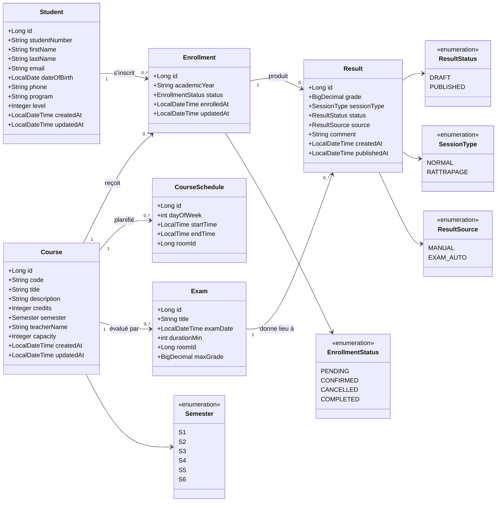

# Diagramme de classes — Academic Service

Diagramme Mermaid (à visualiser sur GitHub/GitLab, ou sur https://mermaid.live
puis exporter en PNG/SVG pour le rapport).

## Règles métier portées par le modèle

- Un étudiant ne peut s'inscrire qu'une fois à un cours pour une année
  académique donnée (`UNIQUE (student_id, course_id, academic_year)`).
- Une note est comprise entre 0 et 20.
- Un résultat est unique par (inscription, examen, type de session).
- `Exam.roomId` et `CourseSchedule.roomId` sont des **références logiques**
  vers le service Smart Space (pas de clé étrangère entre services).
