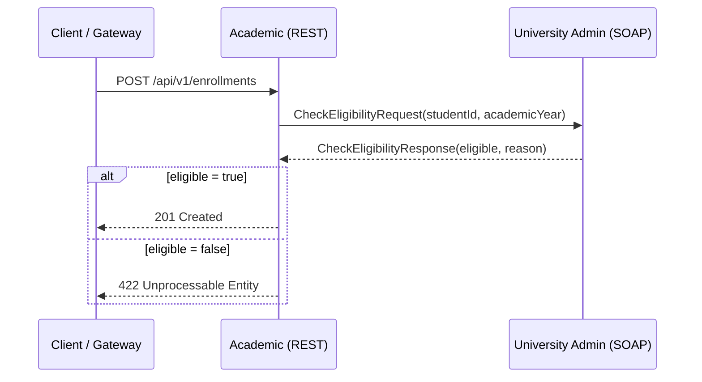

# Points d'intégration — Academic Service

Le service Academic (REST) est le point d'entrée métier. Il appelle deux
services en aval, avec deux protocoles différents :

| Appel | Protocole | Service cible | Déclencheur côté Academic |
|---|---|---|---|
| Vérifier l'éligibilité | SOAP | University Administration | `POST /api/v1/enrollments` |
| Soumettre une certification | SOAP | University Administration | `POST /api/v1/certification-requests` |
| Vérifier / réserver une salle | gRPC (unary) | Smart Space & Exam | planification d'un examen |
| Suivre la correction d'un examen | gRPC (server streaming) | Smart Space & Exam | récupération des résultats d'examen |

> ⚠️ Les noms de services/RPC/messages ci-dessous sont à **aligner avec
> `room.proto` (M3), `exam.proto` (M4) et le WSDL (M5)** dès qu'ils sont poussés.

## 1. REST → SOAP (University Administration)

Client : `WebServiceTemplate` (Spring-WS), contract-first à partir du WSDL de M5.

### 1.1 CheckEligibility

Appelé pendant `POST /api/v1/enrollments`.



Exemple de message (exemple indicatif, à valider avec le XSD de M5) :

```xml
<soapenv:Envelope xmlns:soapenv="http://schemas.xmlsoap.org/soap/envelope/"
                  xmlns:uni="http://educampus.tn/university-administration">
  <soapenv:Body>
    <uni:CheckEligibilityRequest>
      <uni:studentId>1</uni:studentId>
      <uni:academicYear>2026-2027</uni:academicYear>
    </uni:CheckEligibilityRequest>
  </soapenv:Body>
</soapenv:Envelope>
```

### 1.2 SubmitCertification

Appelé par `POST /api/v1/certification-requests`. Réponse REST `202 Accepted`
avec le statut renvoyé par l'administration
(`SUBMITTED`, `IN_REVIEW`, `APPROVED`, `REJECTED`).

### 1.3 Gestion des erreurs SOAP

| Situation | Réaction Academic | Code HTTP |
|---|---|---|
| `eligible = false` | Refus métier | 422 |
| SOAP Fault « étudiant inconnu » | Mapping vers erreur métier | 404 |
| Timeout / service injoignable | Repli (fallback) | 503 |
| Circuit breaker ouvert | Repli immédiat | 503 |

## 2. REST → gRPC (Smart Space & Exam)

Client : stubs générés depuis `room.proto` et `exam.proto`, via `ManagedChannel`.

### 2.1 Salles (unary)

- `RoomService.CheckAvailability(roomId, start, end)` → disponible oui/non.
- `RoomService.CreateReservation(...)` → réservation d'une salle pour un examen.
- Règle anti-chevauchement portée par Smart Space (voir M3) ; Academic
  stocke seulement `room_id` dans `exams` / `course_schedules`.

### 2.2 Examens (server streaming)

- `ExamService.StreamExamProgress(examId)` : flux d'événements de correction.
- À la fin du flux, Academic crée un `Result` avec `source = EXAM_AUTO`
  via sa logique interne (même règle de validation que `POST /api/v1/results`).

### 2.3 Deadlines et statuts gRPC

Chaque appel utilise `stub.withDeadlineAfter(...)` (valeur configurable).

| Statut gRPC | Mapping HTTP côté Academic |
|---|---|
| `OK` | 200 / 201 |
| `INVALID_ARGUMENT` | 400 |
| `NOT_FOUND` | 404 |
| `ALREADY_EXISTS` (chevauchement) | 409 |
| `DEADLINE_EXCEEDED` | 503 (ou 504) |
| `UNAVAILABLE` | 503 |

## 3. Résilience (Resilience4j)

À appliquer sur chaque appel sortant (SOAP et gRPC) :

- **Timeout** explicite sur tout appel réseau.
- **Retry** avec backoff exponentiel (3 tentatives max) pour les erreurs transitoires.
- **Circuit breaker** avec méthode de repli retournant une erreur 503 propre
  (ou un résultat dégradé documenté).

Exemple de configuration (`application.yml`) :

```yaml
resilience4j:
  circuitbreaker:
    instances:
      universityAdmin:
        slidingWindowSize: 10
        failureRateThreshold: 50
        waitDurationInOpenState: 10s
  retry:
    instances:
      universityAdmin:
        maxAttempts: 3
        waitDuration: 500ms
        enableExponentialBackoff: true
```

## 4. Configuration (variables d'environnement)

| Variable | Exemple | Rôle |
|---|---|---|
| `UNIVERSITY_ADMIN_URL` | `http://university-admin:8083/ws` | Endpoint SOAP |
| `SMART_SPACE_GRPC_HOST` | `smart-space` | Hôte gRPC (DNS Docker) |
| `SMART_SPACE_GRPC_PORT` | `9090` | Port gRPC |
| `GRPC_DEADLINE_MS` | `2000` | Deadline des appels gRPC |
| `SOAP_TIMEOUT_MS` | `3000` | Timeout SOAP |

Aucun secret en dur : tout passe par `.env` / variables d'environnement
(voir `.env.example` de M7). Les ports ci-dessus sont des exemples à aligner
avec le `docker-compose.yml`.
