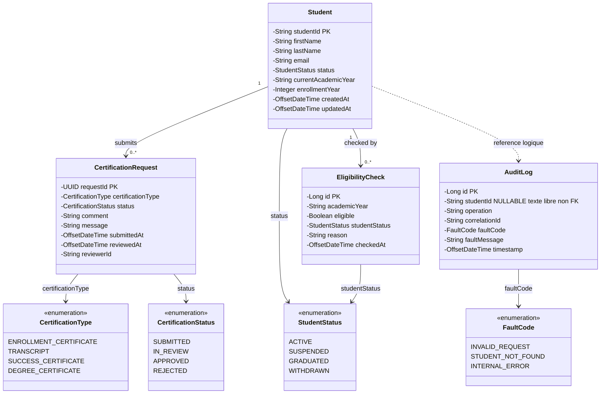

# University Administration Service - Modele de donnees & exemples SOAP

Contrat de reference : `university-administration.xsd` (Membre 5)
Namespace : `http://educampus.com/soap/university-administration` (prefixe `uni`)
Endpoint : `http://localhost:8083/ws` - SOAP 1.1, style document/literal

---

## 1. Diagramme de classes



La cle etrangere `studentId` n'est pas repetee dans `CertificationRequest` et `EligibilityCheck` :
elle est exprimee par les associations `submits` et `checked by` (1 - 0..*).
`AuditLog` n'a aucune association avec `Student` : `studentId` y est un texte libre, nullable.

## 2. Description des entites

| Entite | Role | Lien avec le XSD |
|---|---|---|
| `Student` | Statut administratif de l'etudiant | `StudentId`, `StudentStatus` |
| `EligibilityCheck` | Trace de chaque `CheckEligibility` | `eligible`, `studentStatus`, `reason`, `checkedAt`, `academicYear` |
| `CertificationRequest` | Demande officielle de certification | `requestId`, `certificationType`, `status`, `submittedAt`, `comment`, `message` |
| `AuditLog` | Journal des SOAP Faults | `FaultCode`, `ServiceFault` |

## 3. Statuts de certification

| Statut | Signification |
|---|---|
| `SUBMITTED` | Demande recue (statut initial, renvoye par `SubmitCertification`) |
| `IN_REVIEW` | En cours d'examen par l'administration |
| `APPROVED` | Demande acceptee |
| `REJECTED` | Demande refusee |

Transitions : `SUBMITTED -> IN_REVIEW -> APPROVED | REJECTED`

## 4. Regle d'eligibilite

Un etudiant est **eligible** uniquement si `studentStatus = ACTIVE`.
Sinon `eligible = false` et `reason` explique le motif (ex. `Student is SUSPENDED`).

---

## 5. Exemples SOAP

### 5.1 CheckEligibility - etudiant eligible

**Requete**
```xml
<soapenv:Envelope xmlns:soapenv="http://schemas.xmlsoap.org/soap/envelope/"
                  xmlns:uni="http://educampus.com/soap/university-administration">
  <soapenv:Header/>
  <soapenv:Body>
    <uni:CheckEligibilityRequest>
      <uni:studentId>STU-2026-001</uni:studentId>
      <uni:academicYear>2026-2027</uni:academicYear>
    </uni:CheckEligibilityRequest>
  </soapenv:Body>
</soapenv:Envelope>
```

**Reponse**
```xml
<SOAP-ENV:Envelope xmlns:SOAP-ENV="http://schemas.xmlsoap.org/soap/envelope/">
  <SOAP-ENV:Header/>
  <SOAP-ENV:Body>
    <ns2:CheckEligibilityResponse xmlns:ns2="http://educampus.com/soap/university-administration">
      <ns2:studentId>STU-2026-001</ns2:studentId>
      <ns2:eligible>true</ns2:eligible>
      <ns2:studentStatus>ACTIVE</ns2:studentStatus>
      <ns2:checkedAt>2026-11-15T10:30:00Z</ns2:checkedAt>
    </ns2:CheckEligibilityResponse>
  </SOAP-ENV:Body>
</SOAP-ENV:Envelope>
```

### 5.2 CheckEligibility - etudiant non eligible

**Requete**
```xml
<soapenv:Envelope xmlns:soapenv="http://schemas.xmlsoap.org/soap/envelope/"
                  xmlns:uni="http://educampus.com/soap/university-administration">
  <soapenv:Body>
    <uni:CheckEligibilityRequest>
      <uni:studentId>STU-2026-002</uni:studentId>
    </uni:CheckEligibilityRequest>
  </soapenv:Body>
</soapenv:Envelope>
```

**Reponse**
```xml
<SOAP-ENV:Envelope xmlns:SOAP-ENV="http://schemas.xmlsoap.org/soap/envelope/">
  <SOAP-ENV:Body>
    <ns2:CheckEligibilityResponse xmlns:ns2="http://educampus.com/soap/university-administration">
      <ns2:studentId>STU-2026-002</ns2:studentId>
      <ns2:eligible>false</ns2:eligible>
      <ns2:studentStatus>SUSPENDED</ns2:studentStatus>
      <ns2:reason>Student is SUSPENDED</ns2:reason>
      <ns2:checkedAt>2026-11-15T10:32:10Z</ns2:checkedAt>
    </ns2:CheckEligibilityResponse>
  </SOAP-ENV:Body>
</SOAP-ENV:Envelope>
```

### 5.3 SubmitCertification - succes

**Requete**
```xml
<soapenv:Envelope xmlns:soapenv="http://schemas.xmlsoap.org/soap/envelope/"
                  xmlns:uni="http://educampus.com/soap/university-administration">
  <soapenv:Body>
    <uni:SubmitCertificationRequest>
      <uni:studentId>STU-2026-001</uni:studentId>
      <uni:certificationType>TRANSCRIPT</uni:certificationType>
      <uni:comment>Pour candidature de master</uni:comment>
    </uni:SubmitCertificationRequest>
  </soapenv:Body>
</soapenv:Envelope>
```

**Reponse**
```xml
<SOAP-ENV:Envelope xmlns:SOAP-ENV="http://schemas.xmlsoap.org/soap/envelope/">
  <SOAP-ENV:Body>
    <ns2:SubmitCertificationResponse xmlns:ns2="http://educampus.com/soap/university-administration">
      <ns2:requestId>3f2b8c1e-6a4d-4e7b-9c15-2d8a7e5b1f90</ns2:requestId>
      <ns2:studentId>STU-2026-001</ns2:studentId>
      <ns2:status>SUBMITTED</ns2:status>
      <ns2:submittedAt>2026-11-15T10:35:00Z</ns2:submittedAt>
      <ns2:message>Certification request submitted successfully</ns2:message>
    </ns2:SubmitCertificationResponse>
  </SOAP-ENV:Body>
</SOAP-ENV:Envelope>
```

### 5.4 SOAP Fault - STUDENT_NOT_FOUND

**Requete**
```xml
<soapenv:Envelope xmlns:soapenv="http://schemas.xmlsoap.org/soap/envelope/"
                  xmlns:uni="http://educampus.com/soap/university-administration">
  <soapenv:Body>
    <uni:CheckEligibilityRequest>
      <uni:studentId>STU-9999-999</uni:studentId>
    </uni:CheckEligibilityRequest>
  </soapenv:Body>
</soapenv:Envelope>
```

**Reponse (Fault)**
```xml
<SOAP-ENV:Envelope xmlns:SOAP-ENV="http://schemas.xmlsoap.org/soap/envelope/">
  <SOAP-ENV:Body>
    <SOAP-ENV:Fault>
      <faultcode>SOAP-ENV:Client</faultcode>
      <faultstring>Student not found</faultstring>
      <detail>
        <ns2:ServiceFault xmlns:ns2="http://educampus.com/soap/university-administration">
          <ns2:code>STUDENT_NOT_FOUND</ns2:code>
          <ns2:message>No student with id STU-9999-999</ns2:message>
          <ns2:timestamp>2026-11-15T10:40:00Z</ns2:timestamp>
        </ns2:ServiceFault>
      </detail>
    </SOAP-ENV:Fault>
  </SOAP-ENV:Body>
</SOAP-ENV:Envelope>
```

### 5.5 SOAP Fault - INVALID_REQUEST (type de certification inconnu)

**Requete**
```xml
<soapenv:Envelope xmlns:soapenv="http://schemas.xmlsoap.org/soap/envelope/"
                  xmlns:uni="http://educampus.com/soap/university-administration">
  <soapenv:Body>
    <uni:SubmitCertificationRequest>
      <uni:studentId>STU-2026-001</uni:studentId>
      <uni:certificationType>PASSPORT</uni:certificationType>
    </uni:SubmitCertificationRequest>
  </soapenv:Body>
</soapenv:Envelope>
```

**Reponse (Fault)**
```xml
<SOAP-ENV:Envelope xmlns:SOAP-ENV="http://schemas.xmlsoap.org/soap/envelope/">
  <SOAP-ENV:Body>
    <SOAP-ENV:Fault>
      <faultcode>SOAP-ENV:Client</faultcode>
      <faultstring>Invalid request</faultstring>
      <detail>
        <ns2:ServiceFault xmlns:ns2="http://educampus.com/soap/university-administration">
          <ns2:code>INVALID_REQUEST</ns2:code>
          <ns2:message>certificationType must be one of ENROLLMENT_CERTIFICATE, TRANSCRIPT, SUCCESS_CERTIFICATE, DEGREE_CERTIFICATE</ns2:message>
          <ns2:timestamp>2026-11-15T10:42:00Z</ns2:timestamp>
        </ns2:ServiceFault>
      </detail>
    </SOAP-ENV:Fault>
  </SOAP-ENV:Body>
</SOAP-ENV:Envelope>
```
